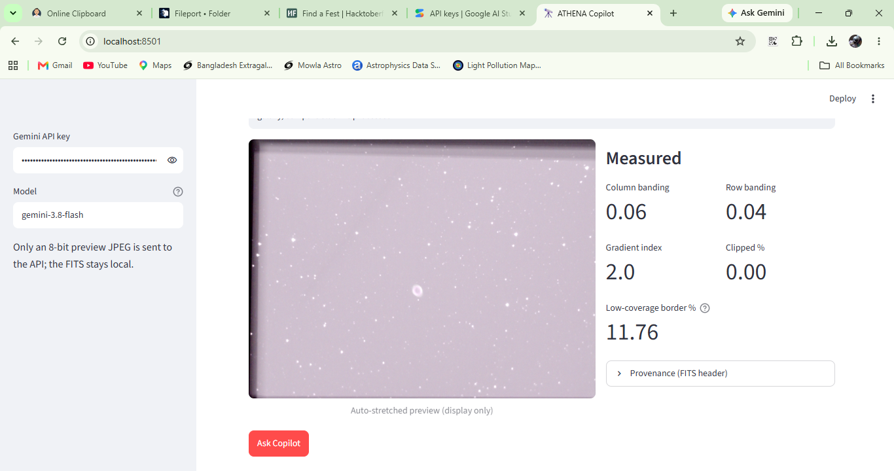
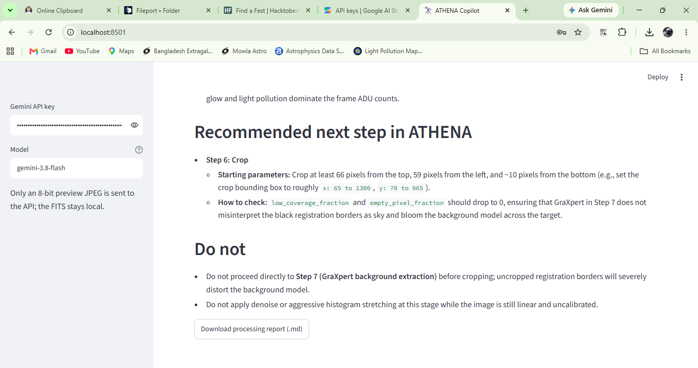
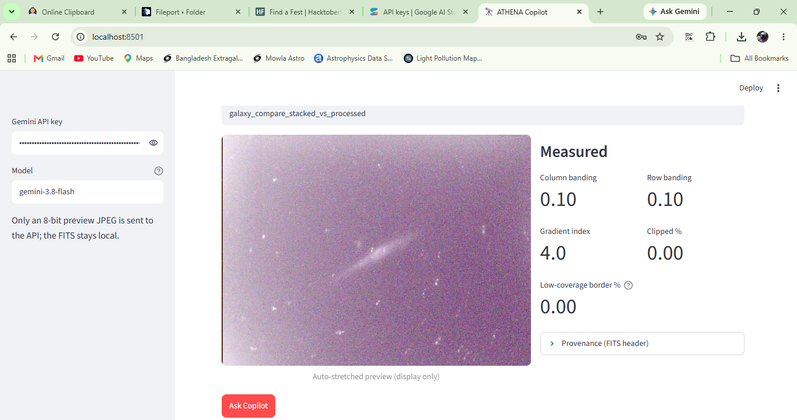
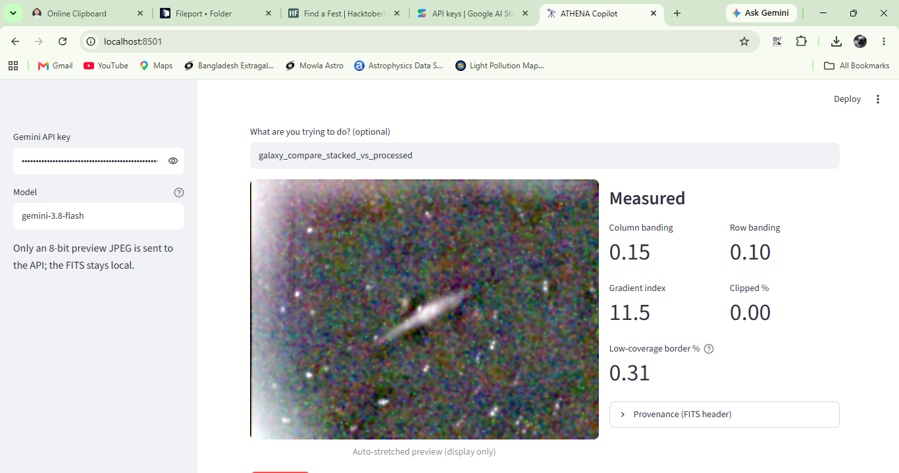

# ATHENA Copilot

A companion tool for [ATHENA](https://github.com/cassaiub/athena), the open-source astrophotography processing tool. Built for an MLH hackathon.

Upload a stacked FITS image (or a PNG/JPG preview) and ATHENA Copilot:

1. **Measures** simple, reproducible quality numbers with numpy (no AI): column/row banding, background gradient, clipping, low-coverage registration borders, and whether the data is still linear or already processed.
2. **Reads provenance** (CREATOR / CALSTAT / HISTORY and capture keywords) from the FITS header.
3. **Explains** the numbers with Gemini: it sends a small stretched preview, the metrics and ATHENA's processing notes, and gets back what it sees, likely causes (labelled as hypotheses), the one recommended next step in the ATHENA chain, and what not to do.

The numbers are computed; the AI only explains them. Raw data never leaves your machine — only an 8-bit preview JPEG is sent to the API. Each result can be downloaded as a Markdown processing report.

## Run it

Needs Python 3 and a [Gemini API key](https://aistudio.google.com/apikey).

```bat
py -m venv .venv
.venv\Scripts\pip install -r requirements.txt
set GEMINI_API_KEY=your-key-here
.venv\Scripts\streamlit run app.py
```

Then open http://localhost:8501. You can also paste the API key in the sidebar instead of setting `GEMINI_API_KEY`. The model name is a text box in the sidebar (default `gemini-3.8-flash`).

## Screenshots

**M57 (Ring Nebula) — measured metrics.** The 11.76% low-coverage border comes from registration edges on the left and top.



**M57 — Copilot recommendation.** Crop (ATHENA step 6) before GraXpert background extraction.



**NGC4631 — stacked vs processed.** Column banding rises from 0.10 to 0.15 and the gradient index from 4.0 to 11.5 after processing.




Full Copilot reports for these runs are in [`reports/`](reports/).

## Notes

- The metrics are this tool's own definitions, not ATHENA's internal ones.
- Colour from uncalibrated data is visual, not photometric; the Copilot is told never to claim photometric accuracy.
